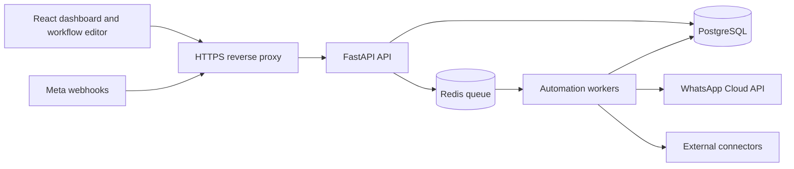

# Architecture

## Current repository state

The repository was empty when work began: no source files, Git metadata, runtime configuration, or existing implementation were present. The project will be built as a new monorepo. Phase 1 establishes the deployable foundation; later phases add domain modules incrementally.

## System shape

The application is a tenant-aware web platform split into a React/TypeScript single-page application and a Python/FastAPI API. PostgreSQL is the source of truth. Redis backs asynchronous work. An API process validates requests and delegates domain behavior to services; workers execute workflows and scheduled work independently of request lifetimes. The reverse proxy terminates TLS in production and routes `/api` to the API and browser traffic to the frontend.

## Boundaries and data flow

- `backend/app/api`: versioned HTTP routes and request/response schemas. Routes authenticate, validate, and call services; they do not own business rules.
- `backend/app/core`: environment settings, logging, security primitives, and database session setup.
- `backend/app/models` and `backend/app/db`: normalized SQLAlchemy models, session management, and Alembic migrations.
- `backend/app/services`: domain use cases, including consent-aware message dispatch and tenant-scoped access.
- `backend/app/integrations`: provider interfaces and adapters. The production WhatsApp adapter uses the official Cloud API; a clearly marked mock adapter is for development only.
- Other applications connect through explicit REST/webhook connectors and service-specific adapters; support is added and verified per integration.
- `backend/app/workers`: queue entry points and durable workflow execution. Delays are represented as scheduled state, not sleeping workers.
- `frontend/src`: typed API client, feature modules, shared layout, and React Flow workflow editor.
- `infrastructure`: Compose, proxy, and operational configuration.

Incoming webhook events are signature-checked where supported, deduplicated by provider event ID, persisted, then enqueued. Outbound messages pass consent/opt-out and policy checks before dispatch. Provider status callbacks update persisted message state. Workflow runs use an idempotency key and store run/node state so retries do not repeat already completed side effects.

## Persistence and tenant isolation

Core records use UUID primary keys, UTC timestamps, explicit foreign keys, and indexes for tenant-scoped access and time-ordered queries. Organization-owned rows carry `organization_id`; service/repository methods require an authenticated organization context. PostgreSQL row-level security may be added as defense in depth after application-level isolation is covered. JSONB is reserved for versioned workflow configuration and provider payloads that are genuinely variable; identity, status, ownership, and queryable relationships remain relational columns.

Planned entities include users, organizations, memberships, WhatsApp accounts, contacts/tags, conversations/messages, templates, workflow definitions/versions/nodes/edges, executions/node executions, scheduled jobs, campaigns/recipients, integrations, webhook events, and audit logs. Retention and deletion policies will be documented per data class before production use.

## Security and compliance

- Passwords are stored as strong one-way hashes; sessions/tokens have expiry and revocation strategy.
- Tenant authorization is checked on every organization-owned resource access.
- Provider credentials are encrypted with a deployment-managed key; no secrets are committed or returned to clients.
- Webhooks use provider verification/signatures, bounded payload validation, and dedupe keys.
- Message sending checks consent, opt-out, WhatsApp template/window policy, account configuration, and rate limits.
- External HTTP integrations enforce destination allowlists/private-network protections, timeouts, response limits, and secret redaction to reduce SSRF and data leakage.
- AI retrieval treats documents as untrusted input and does not authorize business facts absent from trusted business data.
- Audit events cover sensitive administrative and credential changes. Logs avoid message bodies and secrets by default.

Production deployment requires Meta business/app configuration, approved templates as applicable, HTTPS, a managed encryption key, database/Redis backups, monitoring, and operational retention policies. Local mock mode cannot demonstrate delivery to WhatsApp.

This product targets WhatsApp Business Platform accounts. Personal WhatsApp accounts are not supported through the official Cloud API, and unofficial WhatsApp Web automation is outside the supported integration model. The [official developer hub](https://whatsappbusiness.com/developers/developer-hub/) and [Business Messaging Policy](https://whatsappbusiness.com/policy/) are the sources of truth for setup, supported features, consent, templates, and messaging rules.

## Operations

Docker Compose provides local PostgreSQL, Redis, API, worker, and frontend services. Health endpoints report application and dependency readiness without exposing secrets. Structured logs include correlation IDs. Production adds TLS termination, managed database/Redis, backups, metrics/alerts, and a dead-letter workflow for failed jobs.

## Initial milestone scope

Phase 1 creates the repository skeleton, settings, health/readiness API, organization/user/membership schema and migration, authentication foundation, dashboard shell, and local service topology. It does not claim WhatsApp delivery, workflow execution, or production readiness until later phases implement and verify those paths.
